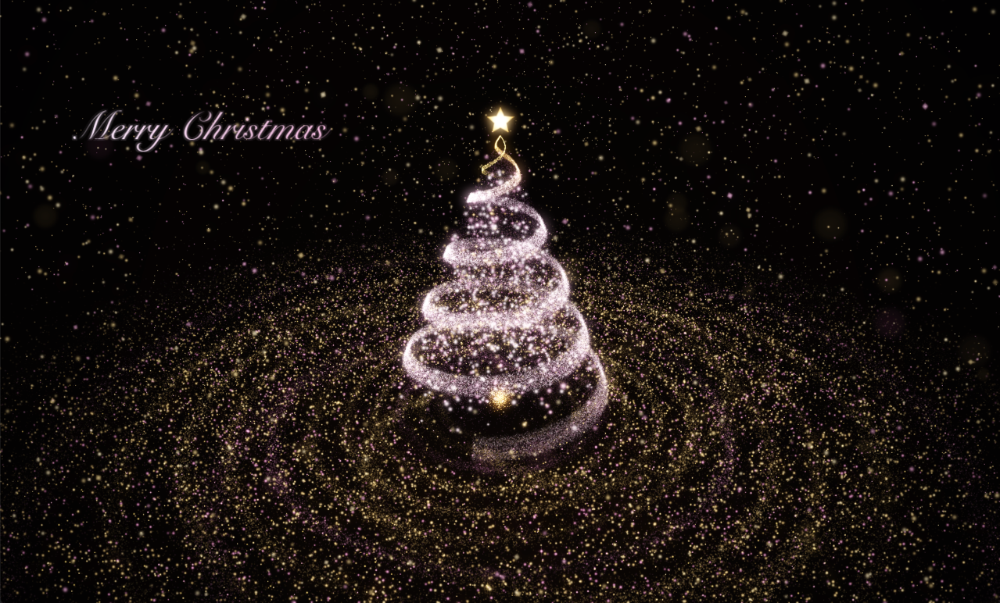

# Pink & Gold Galaxy Christmas Tree

An interactive 3D Christmas tree built with Python, ModernGL, Pygame, and NumPy.

A sparkling Christmas scene featuring golden stars, pink and gold particles, swirling galaxy rings, and animated snowfall.



## Features

- Interactive 3D particle Christmas tree
- Glowing golden star and pink-white light ribbons
- Animated snowfall and sparkling galaxy background
- Pink and gold particle rings
- Camera rotation and zoom
- Screenshot capture

## Requirements

- Python 3.10+
- NumPy
- Pygame
- ModernGL
- An OpenGL 3.3+ compatible environment

## Installation

```bash
pip install -r requirements.txt
```

## Run

```bash
python purple_christmas_tree_fixed_layout.py
```

For lower graphics quality:

```bash
python purple_christmas_tree_fixed_layout.py --quality low
```

## Controls

| Key | Action |
|---|---|
| Mouse drag | Rotate camera |
| Mouse wheel | Zoom |
| Space | Toggle auto-rotation |
| R | Reset camera |
| S | Save screenshot |
| Esc | Exit |

## About

A personal Christmas animation project inspired by glowing particle art and festive galaxy aesthetics.

Merry Christmas!
